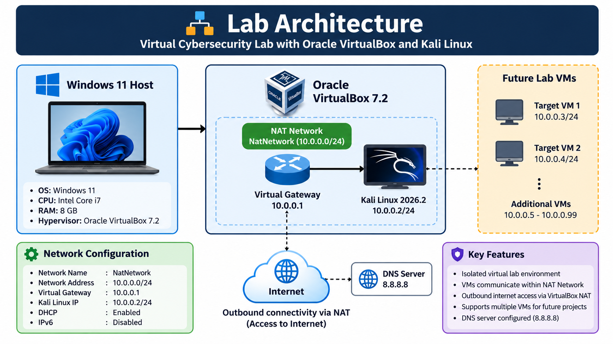
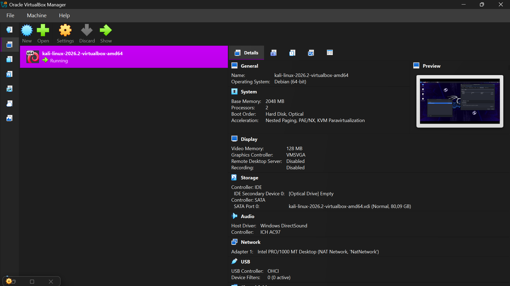
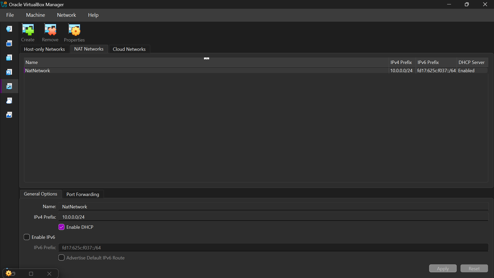
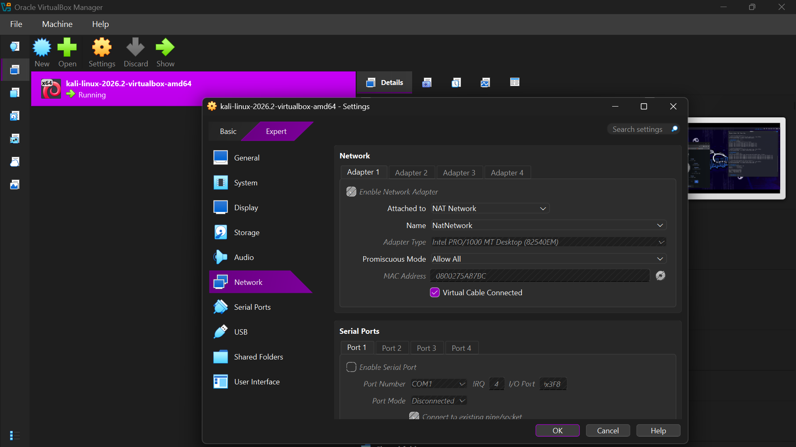
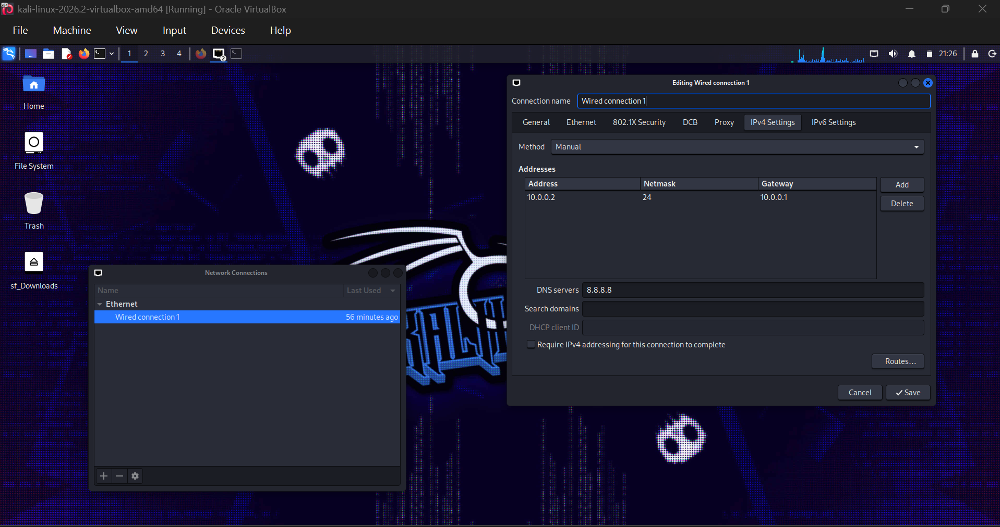
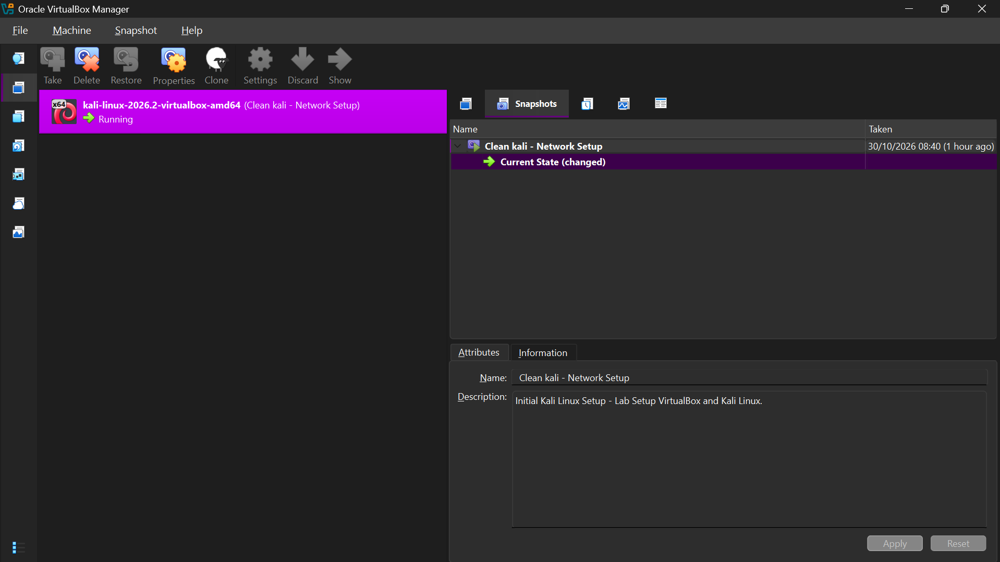
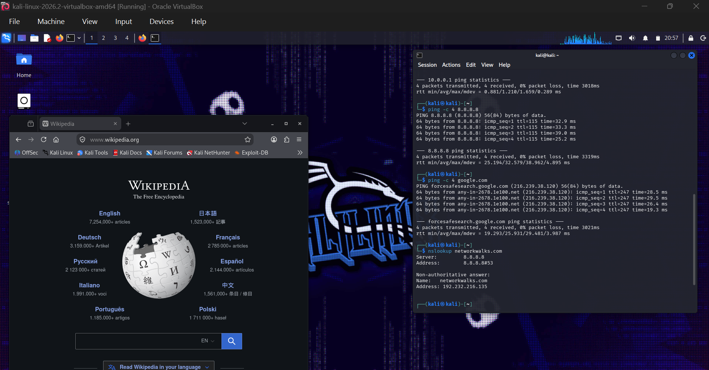

<div align="center">

# 🔐 Cybersecurity Lab Environment Setup

**Building an isolated virtual lab for penetration testing and ethical hacking practice**

**Networkwalks Cybersecurity Internship | Batch B084M | Week 1, Project Module 1**


</div>

---

## 📌 Project Overview

This project documents the setup of a **virtual cybersecurity and penetration-testing laboratory** using Oracle VirtualBox and Kali Linux. It is part of **Networkwalks Cybersecurity Internship, Batch B084M, Week 1, Project Module 1**.

The environment uses a dedicated **NAT Network** to support networking exercises and future authorized security testing. This repository records the setup, screenshots, connectivity tests, troubleshooting, and recovery snapshot.

## 🎯 Objectives

- Install and configure Oracle VirtualBox and Kali Linux.
- Create a NAT Network with the IPv4 prefix `10.0.0.0/24`.
- Configure Kali Linux with the intended static address `10.0.0.2/24`.
- Verify gateway, internet connectivity, and DNS resolution.
- Configure a shared folder between Windows and Kali Linux.
- Configure and test VM integration features where supported.
- Create a clean VM snapshot for recovery.
- Document configuration decisions, evidence, and troubleshooting.

## 🛡️ Purpose of the Lab

The lab provides a controlled environment for learning virtualization, Linux networking, reconnaissance, packet analysis, vulnerability assessment, and other authorized security exercises. Future target VMs may be connected to the same lab network.

## 🏗️ Lab Architecture



The NAT Network supports communication between VMs attached to it and outbound connectivity through VirtualBox NAT. It is not a guarantee of complete isolation from external networks.

## ⚙️ Lab Configuration

| Component | Configuration |
|---|---|
| Host OS | Windows 11 |
| Hypervisor | Oracle VirtualBox |
| Guest OS | Kali Linux 2026.2 (64-bit) |
| Guest RAM | 2048 MB |
| Guest CPUs | 2 |
| Network adapter | Intel PRO/1000 MT Desktop |
| Attachment | NAT Network (`NatNetwork`) |
| NAT Network IPv4 prefix | `10.0.0.0/24` |
| NAT Network DHCP | Enabled |
| Intended Kali IPv4 address | `10.0.0.2/24` |
| Default gateway | `10.0.0.1` |
| DNS server | `8.8.8.8` |
| Shared folder | Windows Downloads → `/media/sf_Downloads` |
| Snapshot | `Clean kali - Network Setup` |

---

## 🪜 Lab Setup Procedure

### Step 1. Prepare the tools

Download Oracle VirtualBox and the official Kali Linux VirtualBox image. Use 7-Zip to extract the downloaded archive if needed.

### Step 2. Import Kali Linux into VirtualBox

Open the extracted Kali Linux virtual machine in VirtualBox and configure the VM resources. This lab uses 2048 MB of RAM and two virtual processors.



### Step 3. Create the NAT Network

In VirtualBox Manager, open **Tools → Network → NAT Networks**. Create or select the network with the following settings:

```text
Name:        NatNetwork
IPv4 Prefix: 10.0.0.0/24
DHCP:        Enabled
IPv6:        Disabled
```



### Step 4. Attach Kali Linux to the NAT Network

Open the Kali Linux VM settings and configure **Adapter 1**:

```text
Attached to: NAT Network
Name:        NatNetwork
Adapter:     Intel PRO/1000 MT Desktop
Cable:       Connected
```



### Step 5. Configure IPv4 in Kali Linux

Open the Kali Linux network connection editor and select **Wired connection 1 → IPv4 Settings**. Set the method to **Manual** and enter:

```text
Address: 10.0.0.2
Netmask: 24 (equivalent to 255.255.255.0)
Gateway: 10.0.0.1
DNS:     8.8.8.8
```



Check the active interface and routing configuration:

```bash
ip -4 addr show eth0
ip route
nmcli connection show --active
```

The intended settings are documented above. Their persistence after reconnecting or rebooting should be verified before considering this step fully complete.

### Step 6. Configure host–guest integration

Configure a Windows Downloads shared folder in VirtualBox with auto-mount enabled. In Kali Linux, check the mounted folder:

```bash
ls /media
ls -la /media/sf_Downloads
```

The shared folder mount has been observed. To verify file transfer end to end, create a test file on Windows and confirm that it appears in Kali Linux. Shared Clipboard and Drag-and-Drop should also be tested independently.

### Step 7. Create a clean VM snapshot

After the initial setup, create a snapshot named **Clean kali - Network Setup** from the VirtualBox **Snapshots** tab. This provides a baseline for future recovery.



The snapshot was created on **30 October 2026**. Creating a snapshot does not itself demonstrate that a restore test was performed.

---

## 🔎 Lab Verification

The following commands were used or identified for network verification:

| Test | Command | Observation / purpose |
|---|---|---|
| IPv4 address | `ip -4 addr show eth0` | Inspect Kali IPv4 assignment |
| Routing | `ip route` | Inspect default gateway |
| Gateway connectivity | `ping -c 4 10.0.0.1` | Previously succeeded |
| External IP connectivity | `ping -c 4 8.8.8.8` | Verify outbound IP connectivity |
| Domain connectivity | `ping -c 4 google.com` | Previously succeeded after DNS troubleshooting |
| DNS lookup | `nslookup networkwalks.com` | Domain resolved during testing |
| Nmap availability | `nmap --version` | Optional tool check; not claimed as verified |
| Snapshot recovery | Restore snapshot and recheck IP | Not claimed as tested |



**Observed result:** Gateway, external IP, and domain connectivity tests succeeded during the recorded testing session. Final persistence of the static IPv4 configuration after a reboot still needs confirmation.

---

## 🐞 Problems Encountered & Solutions

### 1. DNS resolution failure

**Problem:** Kali Linux could access IP addresses but initially failed to resolve domain names, returning `Temporary failure in name resolution`.

**Troubleshooting:** The resolver configuration was inspected and a temporary DNS workaround was applied:

```bash
sudo sh -c 'printf "nameserver 1.1.1.1\nnameserver 8.8.8.8\n" > /etc/resolv.conf'
```

**Result:** Domain connectivity worked after the workaround. The intended permanent DNS server is `8.8.8.8` in NetworkManager. Because NetworkManager may overwrite `/etc/resolv.conf`, DNS should be retested after reconnecting or rebooting.

### 2. Subnet mask and CIDR notation

The lab uses `10.0.0.2/24`. The prefix `/24` is equivalent to the subnet mask `255.255.255.0`. Both represent the same subnet size.

### 3. NetworkManager configuration

The `Wired connection 1` profile and `eth0` interface required troubleshooting. Use `nmcli connection show --active`, `ip -4 addr show eth0`, and `ip route` to verify the actual active configuration rather than relying only on saved values in the editor.

### 4. Disabled Save button

The IPv4 editor's **Save** button was temporarily disabled. The exact cause was not conclusively identified. The configuration should be inspected to confirm whether the profile was saved.

### 5. Windows–Kali shared folder

A Downloads shared folder was configured with auto-mount. The mount path appeared in Kali Linux, but a separate host-to-guest test file is recommended to demonstrate successful transfer.

### 6. Connectivity testing

After troubleshooting DNS, tests to the virtual gateway, external IP, and domain name succeeded. These results demonstrate connectivity during testing, not necessarily after a subsequent restart.

### 7. Snapshot and integration verification

The initial clean snapshot was created. Clipboard, Drag-and-Drop, and snapshot restore functionality should be verified separately before marking those tests complete.

### Troubleshooting Summary

| Issue | Status |
|---|---|
| DNS resolution | Resolved during testing |
| Subnet mask / CIDR | Clarified |
| Gateway and external connectivity | Passed during testing |
| NetworkManager persistence | Recheck after reboot |
| Shared folder mount | Observed; file transfer test recommended |
| Clipboard / Drag-and-Drop | Functional test not yet documented |
| Clean snapshot | Created; restore test not documented |

---

## 💡 What I Learned

1. **Virtualization:** Running Kali Linux as a guest operating system in Oracle VirtualBox.
2. **NAT vs NAT Network:** Understanding how a NAT Network can support multiple connected lab VMs.
3. **IPv4 and subnetting:** Configuring addresses, prefix lengths, gateways, and DNS.
4. **Network troubleshooting:** Using `ip`, `ping`, `nslookup`, and NetworkManager to diagnose connectivity problems.
5. **Host–guest integration:** Configuring shared folders and identifying integration features.
6. **Snapshot management:** Creating a recovery baseline before future security exercises.
7. **Technical documentation:** Recording reproducible setup steps, evidence, limitations, and lessons learned.

## 🔐 Security & Ethical Use

This project is for educational and authorized security testing only. Only test systems that you own or have explicit permission to assess.

## 🔗 Tools & Resources

- [7-Zip](https://www.7-zip.org/)
- [Oracle VirtualBox](https://www.virtualbox.org/wiki/Downloads)
- [Kali Linux](https://www.kali.org/get-kali/)
- [Networkwalks](https://networkwalks.com/)

## 👤 Author

**Viqri Ramadhan Waluya**  
Informatics Student, Universitas Gunadarma  
Cybersecurity Intern, Networkwalks | **Batch B084M**

## 📌 Project Information

| Field | Value |
|---|---|
| Program | Networkwalks Cybersecurity Internship |
| Batch | B084M |
| Week | 01 |
| Module | Project Module 1 (PM1) |
| Project | Cybersecurity & Pentesting Lab Setup |
| Platform | Oracle VirtualBox + Kali Linux |
| Documentation | GitHub README and screenshots |

---

<div align="center"><sub>Week 1 • Project Module 1 • Networkwalks Cybersecurity Internship • Batch B084M</sub></div>
